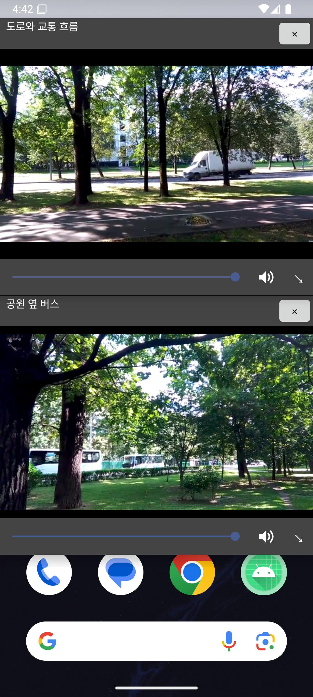
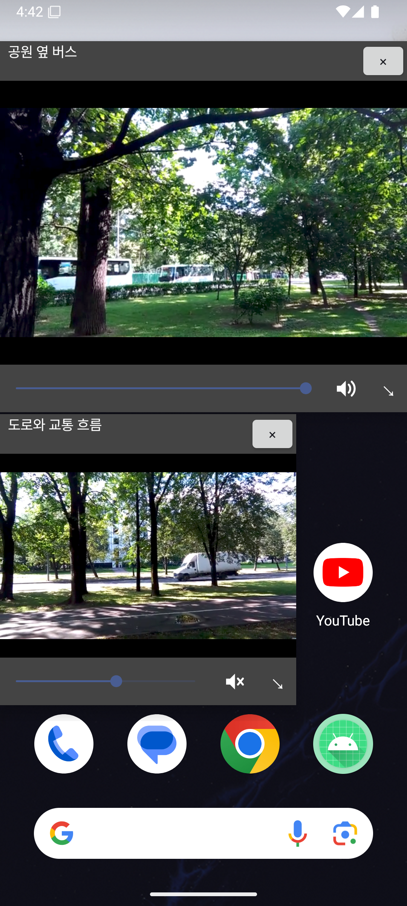

# pocketMix

pocketMix는 Android에서 여러 영상을 각각 조작하며 시청하는 방법을 탐색한 프로젝트입니다. v1에서는 앱 내부의 여러 Pocket 창과 상태 복원을 만들었습니다. v2에서는 앱이 보유한 영상 두 개를 서로 분리된 떠 있는 창으로 표시해, 홈 화면이나 다른 앱을 사용하는 동안에도 각 영상을 조작할 수 있도록 확장했습니다.

> 현재 작업 버전은 `v2-floating-windows` 브랜치입니다. [v1 프로토타입 APK](https://github.com/kwhysee/pocketMix/releases/tag/v1.0.0-prototype.1)는 이전 버전이며, v2 APK는 아직 릴리스하지 않았습니다.

## v2 시연





[떠 있는 창 동작 시연 영상](docs/demo/pocketmix-v2-floating-windows.mp4)

두 창은 pocketMix가 저장한 영상을 표시합니다. 사진의 배경에 보이는 다른 앱의 영상이나 재생 상태를 pocketMix가 제어하는 것은 아닙니다.

## 해결하려는 문제

컴퓨터에서는 여러 창을 배치하고 각각의 소리를 조절하며 작업할 수 있습니다. pocketMix는 모바일에서도 영상마다 독립된 재생·음량·위치 조작이 가능한지 확인하기 위해 시작했습니다.

처음에는 여러 서비스의 PiP 영상을 함께 제어하는 모습을 구상했습니다. 실제 구현 범위는 pocketMix가 소유한 영상으로 정했습니다. v1에서 앱 내부의 동시 재생과 저장을 검증한 뒤, v2에서 두 영상을 앱 밖에 표시하는 기능으로 확장했습니다.

## 버전별 구현

| 버전 | 구현한 내용 | 시연 |
|---|---|---|
| v1 | 앱 내부의 여러 Pocket, 영상별 재생·음량 조절, SQLite 상태 복원, MP4 가져오기 | [v1 영상](docs/demo/pocketmix-demo.mp4) · [v1 APK](https://github.com/kwhysee/pocketMix/releases/tag/v1.0.0-prototype.1) |
| v2 | 앱이 보유한 영상을 별도의 떠 있는 창으로 표시, 창별 이동·크기 변경·재생·음량·음소거 | [v2 영상](docs/demo/pocketmix-v2-floating-windows.mp4) |

v2의 떠 있는 창은 Android 시스템 PiP가 아니라 앱의 오버레이 창입니다.

## 주요 사용 흐름

1. 영상 보관함에서 샘플 영상을 선택하거나 MP4 파일을 가져옵니다.
2. 작업 공간에 서로 다른 영상 두 개를 엽니다.
3. **떠 있는 창으로 보기**를 누릅니다. 처음 사용할 때는 **다른 앱 위에 표시** 권한을 허용합니다.
4. 각 창에서 영상을 재생·일시정지·탐색하고 음량·음소거·위치·크기를 조절합니다.
5. pocketMix로 돌아오면 떠 있는 창을 정리하고 저장된 작업 공간을 일시정지 상태로 다시 엽니다.

작업 공간에서는 전체 일시정지, 창 정렬, Pocket 최소화·닫기도 사용할 수 있습니다. 같은 영상을 다시 선택하면 중복 Pocket을 만들지 않고 기존 Pocket을 엽니다.

## 구현 방식

| 구성 | 역할 |
|---|---|
| Kotlin · Jetpack Compose | 보관함과 앱 내부 작업 공간 화면 |
| Media3 ExoPlayer | 영상별 독립 재생과 탐색 |
| `FloatingVideoService` · Android 오버레이 | 앱 밖에 떠 있는 영상 창 표시 |
| Android 전경 서비스 | 떠 있는 창이 표시되는 동안 재생 서비스 유지 |
| Android 시스템 파일 선택기 | 사용자가 고른 MP4 가져오기 |
| SQLiteOpenHelper | 영상 목록, 시청 위치, 음량, 음소거, Pocket 상태 저장 |

떠 있는 창을 시작할 때 작업 공간의 플레이어를 일시정지하고 현재 위치를 저장한 뒤 해제합니다. 서비스가 영상마다 새 플레이어와 창을 만듭니다. 이를 통해 작업 공간과 떠 있는 창이 같은 영상의 플레이어를 동시에 유지하지 않도록 했습니다.

SQLite의 `videos` 테이블은 영상 정보와 파일 경로를, `playback_states`는 영상별 시청 위치·음량·음소거를, `pocket_states`는 Pocket 배치를 저장합니다. MP4 파일 자체는 SQLite 행에 넣지 않습니다. 샘플 영상은 앱의 assets에, 가져온 영상은 앱 내부 `files/videos/`에 둡니다.

재생 위치는 일시정지·탐색·앱 이탈 시점과 재생 중 약 15초마다 저장합니다. Pocket을 닫아도 영상의 시청 위치와 음량 설정은 보존됩니다.

## 검증한 내용

Android API 35 에뮬레이터에서 다음을 직접 확인했습니다.

- 두 영상의 동시 재생과 개별 재생·일시정지·탐색
- 영상별 음량·음소거 조작
- 떠 있는 창 두 개의 이동과 크기 변경
- 홈 화면 위에서 두 창 표시
- pocketMix로 돌아왔을 때 작업 공간과 시청 상태 복원
- MP4 가져오기와 SQLite의 영상·재생 상태 저장

v1의 데이터 저장·재열기 동작은 Android 계측 테스트로도 확인했습니다.

## 현재 범위

pocketMix는 **앱에 포함된 영상 또는 사용자가 앱으로 가져온 영상**을 재생합니다. YouTube·Netflix 등 다른 앱의 재생 화면을 가져오거나 그 앱의 PiP 창을 제어하지 않습니다.

떠 있는 창을 사용하려면 Android의 **다른 앱 위에 표시** 권한이 필요합니다. 떠 있는 창을 새로 시작하면 창은 기본 위치에 배치됩니다. 실제 휴대전화에서의 동작은 아직 검증하지 않았으며, 동시 재생 성능과 재생 가능한 형식은 기기의 성능과 코덱 지원에 영향을 받을 수 있습니다.

## 직접 실행하기

Android Studio에서 저장소를 열고 Android 에뮬레이터를 실행합니다. 프로젝트의 최소 Android API는 26입니다. 현재 v2 코드를 사용하려면 `v2-floating-windows` 브랜치를 선택합니다.

Windows Git Bash 기준:

```bash
git switch v2-floating-windows
JAVA_HOME="/c/Program Files/Android/Android Studio/jbr" ./gradlew :app:assembleDebug
JAVA_HOME="/c/Program Files/Android/Android Studio/jbr" ./gradlew :app:installDebug
"$HOME/AppData/Local/Android/Sdk/platform-tools/adb.exe" shell am start -n com.kwhysee.pocketmix/.MainActivity
```

첫 Gradle 명령은 디버그 APK를 만들고, 두 번째 명령은 연결된 에뮬레이터에 설치합니다. 마지막 명령은 앱을 엽니다.

## 이전 버전과 참고 자료

- [v1 영상 보관함](docs/screenshots/library.png)
- [v1 앱 내부 두 Pocket](docs/screenshots/workspace.png)
- [v1 동작 시연 영상](docs/demo/pocketmix-demo.mp4)
- [핵심 사용 장면](docs/c1-core-scenarios.md)
- [v1 화면 흐름](docs/c2-screen-flow.md)
- [v1 데이터 흐름](docs/c3-data-flow.md)
- [v1 데이터 형태](docs/c4-data-model.md)
- [v1 완료 기준](docs/c5-acceptance.md)
- [샘플 영상 출처와 사용 조건](docs/sample-video-sources.md)